[**English version**][ext0]

# Moduł PayU dla PrestaShop 1.6, 1.7, 8 i 9

**Jeżeli masz jakiekolwiek pytania lub chcesz zgłosić błąd, zapraszamy do kontaktu z
naszym [wsparciem technicznym][ext13].**

## Spis treści

* [Cechy i kompatybilność](#cechy-i-kompatybilność)
* [Wymagania](#wymagania)
* [Instalacja](#instalacja)
* [Aktualizacja](#aktualizacja)
* [Konfiguracja](#konfiguracja)
    * [Sposób integracji](#sposób-integracji)
    * [Płatności kredytowe](#płatności-kredytowe)
    * [Google Pay i Apple Pay](#google-pay-i-apple-pay)
    * [Parametry POS-ów](#parametry-pos-ów)
    * [Statusy płatności](#statusy-płatności)
* [Logowanie](#logowanie)
* [Więcej o cechach](#więcej-o-cechach)
    * [Kolejność metod płatności](#kolejność-metod-płatności)
    * [Wielowalutowość](#wielowalutowość)
    * [Wyświetlenie metod płatności](#wyświetlenie-metod-płatności)
    * [Płatność kartą](#płatność-kartą)
    * [Płatność kartą - widżet](#widżet-do-płatności-kartą)
    * [Google Pay](#google-pay)
    * [Apple Pay](#apple-pay)
    * [Ponawianie płatności](#ponawianie-płatności)
    * [Status płatności na stronie potwierdzenia zamówienia](#status-płatności-na-stronie-potwierdzenia-zamówienia)
    * [Promowanie płatności ratalnych i odroczonych](#promowanie-płatności-ratalnych-i-odroczonych)
* [Znane problemy](#znane-problemy)

## Cechy i kompatybilność

Moduł płatności PayU dodaje do PrestaShop opcję płatności PayU. Moduł w wersji 3.x wspiera PrestaShop w wersji 1.6, 1.7,
8 i 9 i pozwala na następujące operacje:

| Cecha                                                                          |   PrestaShop 1.6   | PrestaShop 1.7 / 8 / 9 |
|--------------------------------------------------------------------------------|:------------------:|:----------------------:|
| Utworzenie płatności (wraz z rabatami)                                         | :white_check_mark: |   :white_check_mark:   |
| Odebranie lub odrzucenie płatności (w przypadku wyłączonego autoodbioru)       | :white_check_mark: |   :white_check_mark:   |
| Utworzenie zwrotu (pełnego lub częściowego)                                    | :white_check_mark: |   :white_check_mark:   |
| Wyświetlenie metod płatności i wybranie metody na stronie składania zamówienia | :white_check_mark: |   :white_check_mark:   |
| Płatność kartą jako osobna metoda płatności                                    | :white_check_mark: |   :white_check_mark:   |
| Płatność kartą jako widżet                                                     | :white_check_mark: |   :white_check_mark:   |
| Google Pay jako osobna metoda płatności                                        | :white_check_mark: |   :white_check_mark:   |
| Apple Pay jako osobna metoda płatności                                         | :white_check_mark: |   :white_check_mark:   |
| Płatność BLIK jako osobna metoda płatności                                     | :white_check_mark: |   :white_check_mark:   |
| Ponowienie płatności                                                           | :white_check_mark: |   :white_check_mark:   |
| Status płatności na stronie potwierdzenia zamówienia                           |        :x:         |   :white_check_mark:   |
| Wielowalutowość                                                                | :white_check_mark: |   :white_check_mark:   |
| Kolejność metod płatności                                                      | :white_check_mark: |   :white_check_mark:   |
| Płatność [PayU Raty][ext10] jako osobna metoda płatności                       | :white_check_mark: |   :white_check_mark:   |
| Płatność Klarna jako osobna metoda płatności                                   | :white_check_mark: |   :white_check_mark:   |
| Płatność PayPo jako osobna metoda płatności                                    | :white_check_mark: |   :white_check_mark:   |
| Płatność Twisto jako osobna metoda płatności                                   | :white_check_mark: |   :white_check_mark:   |
| Płatność Twisto podziel na 3 jako osobna metoda płatności                      | :white_check_mark: |   :white_check_mark:   |
| Płatność PragmaPay jako osobna metoda płatności                                | :white_check_mark: |   :white_check_mark:   |
| Prezentacja widżetu kredytowego przy produkcie i listingu                      | :white_check_mark: |   :white_check_mark:   |
| Prezentacja widżetu kredytowego na podsumowaniu                                | :white_check_mark: |   :white_check_mark:   |
| Prezentacja widżetu kredytowego w koszyku                                      |        :x:         |   :white_check_mark:   |
| Wykluczenie metod płatności kredytowych z widżetu                              | :white_check_mark: |   :white_check_mark:   |

Więcej informacji o cechach można znaleźć w rozdziale [Więcej o cechach](#więcej-o-cechach).

**Wszystkie opisy w tej instrukcji odnoszą się do PrestaShop 1.7, w innych wersjach należy używać opcji analogicznych.**

## Wymagania

**Ważne:** Moduł działa tylko z punktem płatności typu `REST API` (Checkout). Jeżeli nie posiadasz jeszcze konta w
systemie PayU, [**zarejestruj się w systemie produkcyjnym**][ext4] lub [**zarejestruj się w systemie sandbox**][ext5].

Do prawidłowego funkcjonowania modułu wymagane są następujące rozszerzenia PHP: [cURL][ext1] i [hash][ext2].

## Instalacja

### Opcja 1

**przeznaczona dla użytkowników bez dostępu przez FTP do instalacji PrestaShop**

1. Pobierz plik `payu_prestashop_plugin_X.Y.Z.zip` z najnowszej wersji modułu z [wydań GitHub][ext3].
2. Przejdź do strony administracyjnej swojego sklepu PrestaShop [http://adres-sklepu/adminxxx].
3. Przejdź do `Moduły` » `Menedżer modułów`.
4. Naciśnij przycisk `Załaduj moduł` i wybierz plik z archiwum modułu (pobrany w punkcie 1).

### Opcja 2

**przeznaczona dla użytkowników z dostępem przez FTP do instalacji PrestaShop**

1. Pobierz plik `payu_prestashop_plugin_X.Y.Z.zip` z najnowszej wersji modułu z [wydań GitHub][ext3].
2. Rozpakuj pobrany plik.
3. Połącz się z serwerem FTP i skopiuj zawartość rozpakowanego pliku do katalogu `modules/payu` swojego sklepu
   PrestaShop.

## Aktualizacja

1. Zaktualizuj pliki modułu zgodnie z punktem [Instalacja](#instalacja).
2. Przejdź do `Moduły` » `Menedżer modułów`.
3. W zakładce `Aktualizacje` wykonaj aktualizację modułu, jeżeli będzie dostępna.
4. Przejdź do `Parametry zaawansowane` » `Wydajność` i naciśnij przycisk `Wyczyść pamięć podręczną`.

## Konfiguracja

1. Przejdź do strony administracyjnej swojego sklepu PrestaShop [http://adres-sklepu/adminxxx].
2. Przejdź do `Moduły` » `Menedżer modułów`.
3. Wyszukaj `PayU` i naciśnij `Konfiguruj`.

### Sposób integracji

| Parametr                                                 | Opis                                                                                                                                                                                                                                                                                                                                                   |
|----------------------------------------------------------|--------------------------------------------------------------------------------------------------------------------------------------------------------------------------------------------------------------------------------------------------------------------------------------------------------------------------------------------------------|
| Lista banków                                             | `Tak` - wybór metody płatności PayU będzie możliwy na stronie składania zamówienia, gdy wybrana zostanie płatność *Zapłać przelewem online* [więcej informacji](#wyświetlenie-metod-płatności). `Nie` - po złożeniu zamówienia w PrestaShop nastąpi automatyczne przekierowanie do PayU. Nie włączaj tej opcji, jeżeli używasz modułu OPC [więcej informacji](#prestashop-i-moduły-opc). |
| Kolejność metod płatności                                | Określa kolejność wyświetlanych metod płatności (dotyczy tylko opcji `Lista banków`) [więcej informacji](#kolejność-metod-płatności).                                                                                                                                                                                                                   |
| Płatność kartą jako osobna metoda płatności              | Określa, czy płatność kartą będzie dostępna jako osobna metoda płatności [więcej informacji](#płatność-kartą).                                                                                                                                                                                                                                         |
| Płatność kartą w widżecie                                | Określa, czy płatność kartą będzie dostępna jako widżet [więcej informacji](#widżet-do-płatności-kartą).                                                                                                                                                                                                                                               |
| Płatność BLIK jako osobna metoda płatności               | Określa, czy płatność BLIK będzie dostępna jako osobna metoda płatności.                                                                                                                                                                                                                                                                               |
| Ponowienie płatności                                     | Określa, czy kupujący będzie mógł ponowić nieudaną płatność [więcej informacji](#ponawianie-płatności).                                                                                                                                                                                                                                                |
| Tryb testowy (Sandbox)                                   | `Tak` - transakcje będą procesowane przez system Sandbox PayU. `Nie` - transakcje będą procesowane przez system produkcyjny PayU.                                                                                                                                                                                                                   |
| Zapisuj logi                                             | Określa, czy moduł będzie zapisywać informacje do logów [więcej informacji](#logowanie).                                                                                                                                                                                                                                                               |
| Wyświetl informację o statusie po zakończeniu płatności  | Określa, czy na stronie potwierdzenia zamówienia będzie wyświetlany aktualny status płatności (tylko PrestaShop 1.7 / 8 / 9) [więcej informacji](#status-płatności-na-stronie-potwierdzenia-zamówienia).                                                                                                                                                |

### Płatności kredytowe

| Parametr                                                   | Opis                                                                                                                                                                         |
|------------------------------------------------------------|------------------------------------------------------------------------------------------------------------------------------------------------------------------------------|
| Wyświetl Raty jako osobną metodę płatności                 | Określa, czy PayU Raty będą dostępne jako osobna metoda płatności.                                                                                                           |
| Wyświetl Klarna jako osobną metodę płatności               | Określa, czy Klarna będzie dostępna jako osobna metoda płatności.                                                                                                            |
| Wyświetl PayPo jako osobną metodę płatności                | Określa, czy PayPo będzie dostępne jako osobna metoda płatności.                                                                                                             |
| Wyświetl Twisto jako osobną metodę płatności               | Określa, czy Twisto będzie dostępne jako osobna metoda płatności.                                                                                                            |
| Wyświetl Twisto podziel na 3 jako osobną metodę płatności  | Określa, czy Twisto podziel na 3 będzie dostępne jako osobna metoda płatności.                                                                                               |
| Wyświetl PragmaPay jako osobną metodę płatności            | Określa, czy PragmaPay będzie dostępne jako osobna metoda płatności.                                                                                                         |
| Wyświetl widget kredytowy w koszyku                        | Określa, czy widżet kredytowy będzie wyświetlany w koszyku (tylko PrestaShop 1.7 / 8 / 9).                                                                                   |
| Wyświetl widget kredytowy na podsumowaniu                  | Określa, czy widżet kredytowy będzie wyświetlany na podsumowaniu zamówienia.                                                                                                 |
| Wyświetl widget kredytowy przy produktach                  | Określa, czy widżet kredytowy będzie wyświetlany na karcie produktu i na listingu produktów.                                                                                 |
| Wyklucz metody płatności kredytowych z widgetu             | Lista kodów metod płatności kredytowych oddzielonych przecinkami, które nie będą prezentowane w widżecie, np. `dpt,dpkl,dpp` [więcej informacji](#prezentacja-widżetu-kredytowego). |

Więcej informacji w rozdziale [Promowanie płatności ratalnych i odroczonych](#promowanie-płatności-ratalnych-i-odroczonych).

### Google Pay i Apple Pay

Parametry metod płatności Google Pay i Apple Pay opisane są w rozdziałach [Google Pay](#google-pay)
i [Apple Pay](#apple-pay).

### Parametry POS-ów

Dla każdej waluty dodanej w PrestaShop należy dodać parametry (osobno dla środowiska produkcyjnego i sandbox):

| Parametr              | Opis                                             |
|-----------------------|--------------------------------------------------|
| Id punktu płatności   | Identyfikator POS-a z systemu PayU               |
| Drugi klucz MD5       | Drugi klucz MD5 z systemu PayU                   |
| OAuth - client_id     | client_id dla protokołu OAuth z systemu PayU     |
| OAuth - client_secret | client_secret dla protokołu OAuth z systemu PayU |

### Statusy płatności

Mapowanie statusów płatności w PayU na statusy zamówień w sklepie PrestaShop. Każdy ze statusów można zmienić
w sekcji `Statusy płatności` konfiguracji modułu.

| Parametr                                   | Status w PayU | Domyślny status w PrestaShop |
|--------------------------------------------|---------------|------------------------------|
| Rozpoczęta - status po złożeniu zamówienia |               | Płatność PayU rozpoczęta     |
| Zakończona                                 | `COMPLETED`   | Płatność zaakceptowana       |
| Anulowana                                  | `CANCELED`    | Płatność PayU anulowana      |

## Logowanie

Gdy sklep PrestaShop przełączymy w tryb debugowania lub włączymy opcję `Zapisuj logi`, moduł zapisuje informacje do
logów. Pliki logów znajdą się w katalogu:

* PrestaShop 1.7 / 8 / 9 - `/var/logs`
* PrestaShop 1.6 - `/log`

## Więcej o cechach

### Kolejność metod płatności

Ma zastosowanie tylko przy ustawionej opcji **Lista banków** na `Tak`.

W celu ustalenia kolejności wyświetlanych ikon metod płatności należy podać symbole metod płatności, oddzielając je
przecinkami. [Lista metod płatności][ext6].

### Wielowalutowość

POS w systemie PayU ma jedną walutę. Jeżeli chcemy akceptować płatności w sklepie PrestaShop w wielu walutach, niezbędne
jest dodanie konfiguracji POS-a dla każdej waluty z osobna. Błąd `ERROR_INCONSISTENT_CURRENCIES` oznacza, że waluta nie
jest obsługiwana przez POS. Aby przyjmować płatności w innej walucie, należy skontaktować się z PayU – w środowisku
sandbox w celu jej aktywacji, a w środowisku produkcyjnym w celu zawarcia osobnej umowy.

### Wyświetlenie metod płatności

Przy ustawionej opcji **Lista banków** na `Tak`, po wybraniu płatności przez PayU wyświetli się strona z ikonami banków
bezpośrednio w sklepie PrestaShop. Wyświetlane ikony banków są pobierane z konfiguracji POS-a w PayU w zależności od
wybranej waluty.

![payment_methods][img3]

### Płatność kartą

Przy ustawionej opcji **Płatność kartą jako osobna metoda płatności** na `Tak`, na liście metod płatności w procesie
zakupowym PrestaShop wyświetli się osobna metoda o nazwie `Zapłać kartą`.

Jeżeli opcja **Lista banków** jest ustawiona na `Tak`, to metoda `Zapłać kartą` będzie wyświetlana tylko wtedy, gdy na
POS-ie jest dostępna płatność kartą. W przeciwnym wypadku metoda `Zapłać kartą` będzie wyświetlana zawsze, ale jeżeli
na POS-ie nie ma dostępnej płatności kartą, płatność się nie powiedzie.

![payment_methods][img6]

### Widżet do płatności kartą

**WAŻNE** - do prawidłowego działania niezbędne jest włączenie tokenizacji w konfiguracji POS-a. W tym celu należy się
skontaktować z naszym [wsparciem technicznym][ext13].

Przy ustawionych opcjach **Płatność kartą jako osobna metoda płatności** oraz **Płatność kartą w widżecie** na `Tak`, po
wybraniu płatności `Zapłać kartą` zamiast przekierowania do PayU pojawi się widżet do wprowadzenia danych karty.

![widget][img5]

### Google Pay

Jeżeli w konfiguracji włączona jest opcja `Włącz Google Pay`, to w procesie zakupowym PrestaShop na liście metod
płatności pojawi się metoda `Zapłać z Google Pay`. Po wybraniu tej metody kupujący zostanie przekierowany do okna
płatności Google Pay.

![google_pay][img7]

Parametry dostępne dla metody płatności `Google Pay`:

| Parametr             | Opis                                                                                                                   |
|----------------------|------------------------------------------------------------------------------------------------------------------------|
| Włącz Google Pay     | Określa, czy Google Pay będzie dostępne jako osobna metoda płatności.                                                 |
| Google Merchant Id   | Identyfikator sprzedawcy w Google. Należy zweryfikować swoją stronę w Google, postępując zgodnie z [instrukcją][ext14]. |
| Google Merchant Name | Nazwa sprzedawcy wyświetlana w oknie płatności.                                                                        |

### Apple Pay

Jeżeli w konfiguracji włączona jest opcja `Włącz Apple Pay`, w procesie zakupowym PrestaShop na liście metod płatności
pojawi się osobna metoda `Zapłać z Apple Pay`, pod warunkiem że Apple Pay jest aktywne dla skonfigurowanego POS-a PayU.
Po potwierdzeniu zamówienia na obsługiwanym urządzeniu Apple i w obsługiwanej przeglądarce zostanie otwarte okno
płatności Apple Pay.

![apple_pay][img8]

Przed włączeniem tej opcji należy zarejestrować domenę strony zamówienia dla Apple Pay zgodnie
z [instrukcją PayU][ext15]. Zarejestrowana domena musi być identyczna z domeną, pod którą wyświetlana jest strona
zamówienia. W przeciwnym razie Apple odrzuci żądanie płatności.

Parametry dostępne dla metody płatności `Apple Pay`:

| Parametr         | Opis                                                                                                      |
|------------------|-----------------------------------------------------------------------------------------------------------|
| Włącz Apple Pay  | Określa, czy Apple Pay będzie dostępne jako osobna metoda płatności.                                      |
| Nazwa domeny     | Domena strony zamówienia zarejestrowana dla Apple Pay. Należy podać samą domenę, bez protokołu i ścieżki. |
| Nazwa wyświetlana | Nazwa sklepu wyświetlana w oknie płatności Apple Pay. Może zawierać maksymalnie 64 znaki UTF-8.          |

### Ponawianie płatności

Dzięki tej opcji kupujący otrzymuje możliwość skutecznego opłacenia zamówienia, nawet jeśli pierwsza płatność była
nieudana (np. brak środków na karcie, problemy z logowaniem do banku itp.).

Aby użyć tej opcji, należy również odpowiednio skonfigurować punkt płatności w PayU i wyłączyć automatyczne odbieranie
płatności (domyślnie autoodbiór jest włączony). W tym celu należy zalogować się do panelu PayU, wejść do zakładki
"Płatności elektroniczne", następnie wybrać "Moje sklepy" i punkt płatności na danym sklepie. Opcja "Automatyczny odbiór
płatności" znajduje się na samym dole, pod listą typów płatności.

Ponowienie płatności umożliwia zakładanie wielu płatności w PayU do jednego zamówienia w PrestaShop. Moduł
automatycznie odbierze pierwszą udaną płatność, a pozostałe zostaną anulowane. Ponowienie płatności przez kupującego
jest możliwe:

* poprzez kliknięcie linku znajdującego się w e-mailu potwierdzającym zamówienie,
* w szczegółach zamówienia.

![retry_payment][img4]

### Status płatności na stronie potwierdzenia zamówienia

Przy ustawionej opcji **Wyświetl informację o statusie po zakończeniu płatności** na `Tak`, po powrocie z PayU na
stronie potwierdzenia zamówienia wyświetlany jest aktualny status płatności. Opcja jest dostępna tylko w PrestaShop
1.7 / 8 / 9 i jest domyślnie włączona dla nowych instalacji modułu.

### Promowanie płatności ratalnych i odroczonych

Moduł udostępnia opcje promowania [płatności ratalnych i odroczonych][ext7] (nazywanych również zamiennie "płatnościami
kredytowymi") poprzez wydzielanie poszczególnych metod płatności na podsumowaniu oraz wyświetlanie widżetu kredytowego
przy produktach, w koszyku czy na podsumowaniu. Promowaniem płatności ratalnych i odroczonych można sterować w sekcji
["Płatności kredytowe"](#płatności-kredytowe) panelu administracyjnego modułu. Wydzielanie PayU Raty oraz wyświetlanie
widżetu kredytowego są domyślnie włączone. Wsparcie dla konkretnych funkcjonalności przedstawione zostało w
tabeli [Cechy i kompatybilność](#cechy-i-kompatybilność).

> Prezentacja metod płatności i widżetu zależna jest od dostępności bramek "ai", "dpt", "dpcz", "dpts", "dpkl",
> "dpklczk", "dpkleur", "dpklhuf", "dpp", "dppron", "ppf" na danym punkcie płatności i sprawdzana jest automatycznie
> przez moduł. Jeśli dana metoda płatności kredytowych nie została aktywowana na punkcie płatności, nie zostanie
> zaprezentowana na podsumowaniu ani w widżecie pomimo włączonej opcji w module.

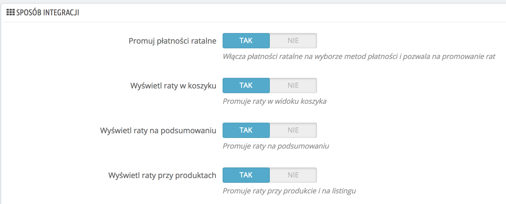

#### Prezentacja płatności ratalnych i odroczonych w zależności od wersji PrestaShop

| Wersja PrestaShop | Kategoria                                              | Prezentacja                                                                         |
|-------------------|--------------------------------------------------------|-------------------------------------------------------------------------------------|
| 1.7               | Listing produktów                                      | 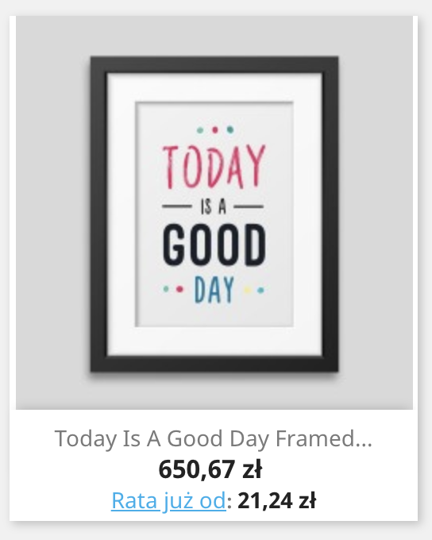                        |
| 1.7               | Karta produktu                                         | 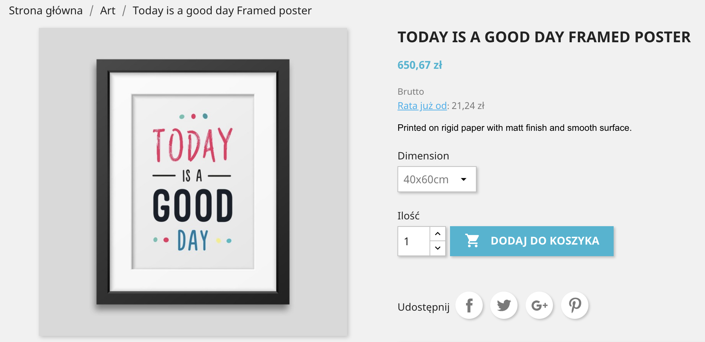                        |
| 1.7               | Koszyk                                                 | 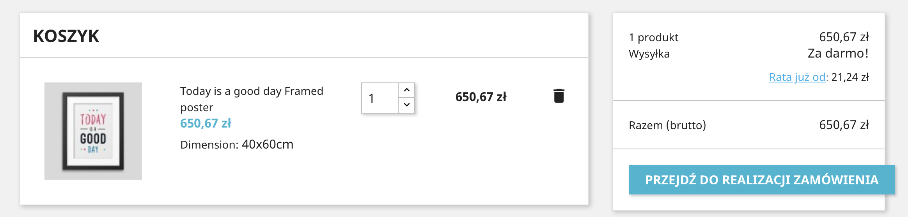                           |
| 1.7               | Wydzielenie PayU Raty jako metody płatności            | 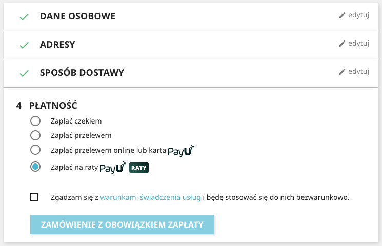 |
| 1.7               | Wydzielenie Klarna jako metody płatności               | 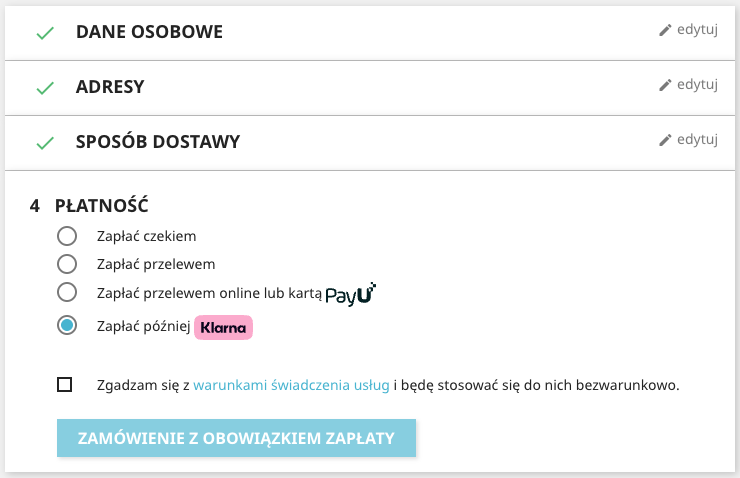       |
| 1.7               | Wydzielenie PayPo jako metody płatności                |         |
| 1.7               | Wydzielenie Twisto jako metody płatności               | 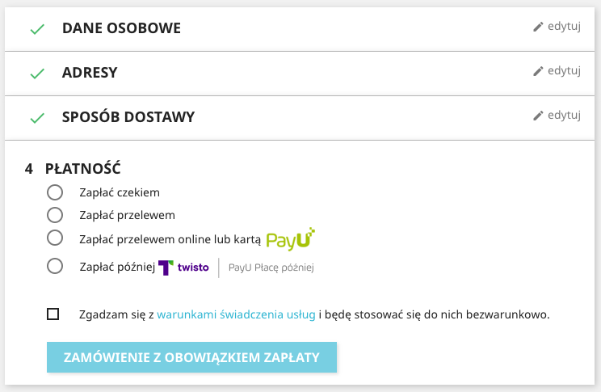       |
| 1.7               | Wydzielenie Twisto podziel na 3 jako metody płatności  | 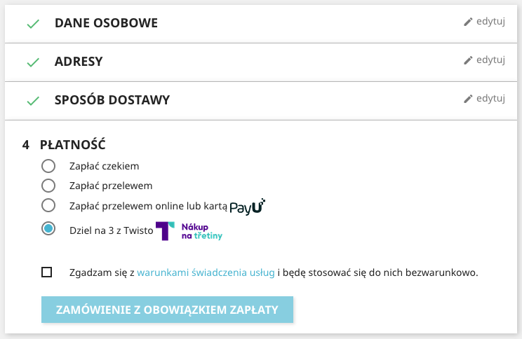 |
| 1.7               | Wydzielenie PragmaPay jako metody płatności            | 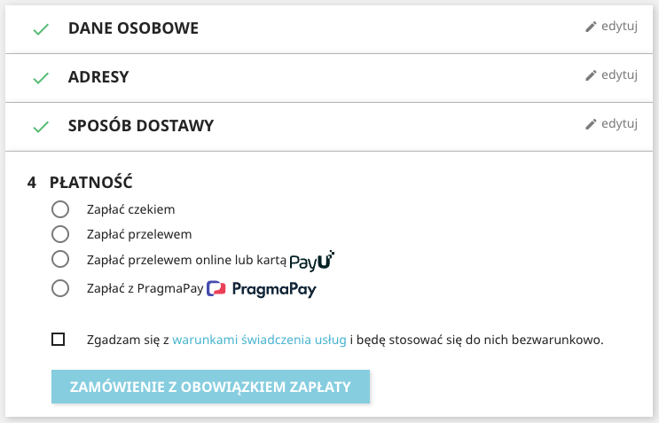   |
| 1.6               | Listing produktów                                      | 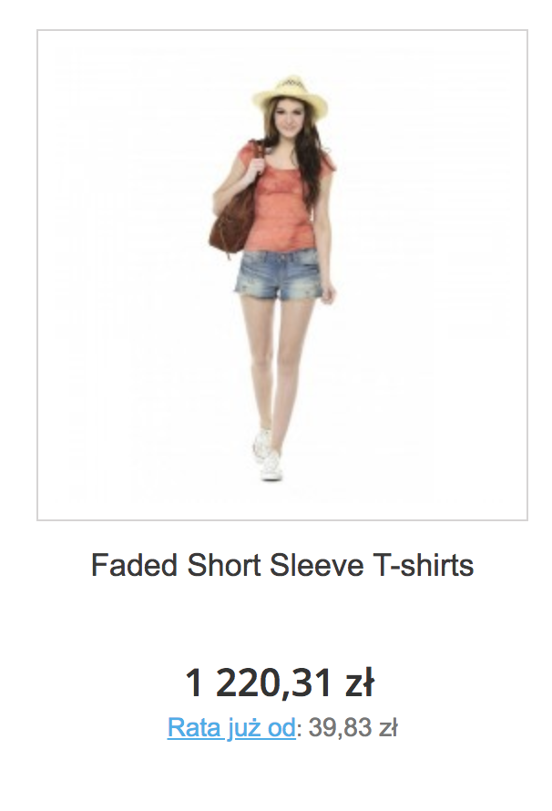                        |
| 1.6               | Karta produktu                                         | 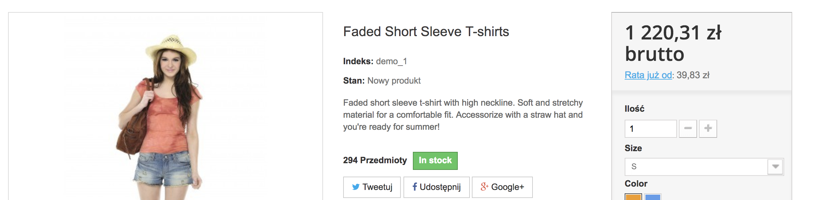                        |

#### Prezentacja widżetu kredytowego

W zależności od dostępnych metod płatności kredytowych, w powyższych sekcjach strony pojawiają się linki: "Rata już od",
"Rata 0% już od" lub "Zapłać później". Po kliknięciu linku pojawia się najnowsza wersja widżetu kredytowego wchodzącego
w skład pakietu [PayU Raty - dobre praktyki][ext12], który znajduje się w [oficjalnej dokumentacji technicznej][ext8].

Widżet kredytowy wygląda następująco:

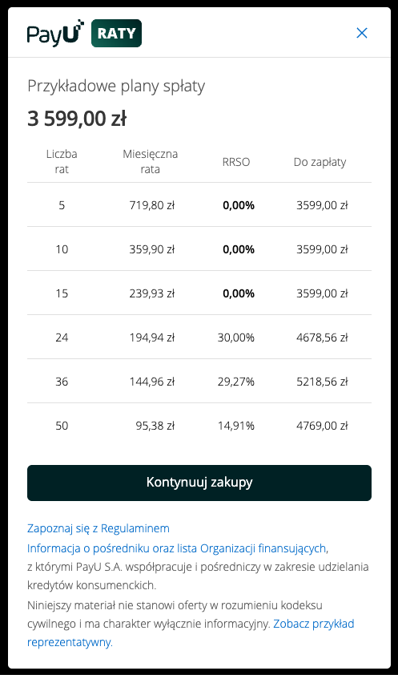

Od wersji 3.3.0 możliwe jest wykluczenie wskazanych metod płatności kredytowych z wyświetlania w widżecie za
pośrednictwem pola "Wyklucz metody płatności kredytowych z widgetu" w konfiguracji modułu. Na przykład wpisanie we
wspomnianym polu wartości `dpp,dpkl,dpt` sprawi, że metody PayPo, Klarna oraz Twisto znikną z widżetu:

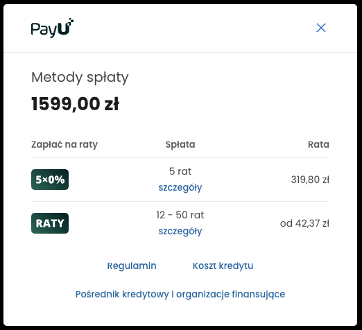

## Znane problemy

### PrestaShop i moduły OPC

Z uwagi na to, że moduły OPC budują własną stronę zamówienia, mogą nie działać niektóre opcje, np. `Lista banków`,
`Płatność kartą jako osobna metoda płatności`, `Płatność BLIK jako osobna metoda płatności` oraz wydzielenie metod
płatności kredytowych. Problemy należy zgłaszać do twórców modułu OPC.

<!--LINKS-->

<!--external links:-->

[ext0]: README.md
[ext1]: http://php.net/manual/en/book.curl.php
[ext2]: http://php.net/manual/en/book.hash.php
[ext3]: https://github.com/PayU-EMEA/plugin_prestashop/releases
[ext4]: https://www.payu.pl/oferta-handlowa
[ext5]: https://secure.snd.payu.com/boarding/?pk_campaign=Plugin-Github&pk_kwd=Prestashop#/form
[ext6]: http://developers.payu.com/pl/overview.html#paymethods
[ext7]: https://developers.payu.com/pl/installments.html
[ext8]: https://developers.payu.com/pl/installments.html#installments_best_practices_mini
[ext10]: https://www.payu.pl/metody-platnosci-dla-biznesu/payu-raty
[ext12]: https://developers.payu.com/pl/installments.html#best_practices_title
[ext13]: https://www.payu.pl/pomoc
[ext14]: https://developers.google.com/pay/api/web/guides/test-and-deploy/publish-your-integration#create-your-profile
[ext15]: https://developers.payu.com/europe/docs/payment-solutions/cards/digital-wallets/apple-pay/

<!--images:-->

[img3]: readme_images/pl/bramki_platnosci.png
[img4]: readme_images/pl/ponow_platnosc.png
[img5]: readme_images/pl/widget.png
[img6]: readme_images/pl/separate_card.png
[img7]: readme_images/pl/google-pay.png
[img8]: readme_images/pl/apple-pay.png
