[**Wersja polska**][ext0]

# PayU module for PrestaShop 1.6, 1.7, 8 and 9

**If you have any questions or want to report a bug, please contact our [technical support][ext13].**

## Table of Contents

* [Features](#features)
* [Prerequisites](#prerequisites)
* [Installation](#installation)
* [Upgrade](#upgrade)
* [Configuration](#configuration)
    * [Integration method](#integration-method)
    * [Credit payments](#credit-payments)
    * [Google Pay and Apple Pay](#google-pay-and-apple-pay)
    * [POS parameters](#pos-parameters)
    * [Payment statuses](#payment-statuses)
* [Logging](#logging)
* [More on features](#more-on-features)
    * [Payment method order](#payment-method-order)
    * [Multi-currency](#multi-currency)
    * [Payment method display](#payment-method-display)
    * [Card payment](#card-payment)
    * [Card payment - widget](#card-payment-widget)
    * [Google Pay](#google-pay)
    * [Apple Pay](#apple-pay)
    * [Payment retry](#payment-retry)
    * [Payment status on the order confirmation page](#payment-status-on-the-order-confirmation-page)
    * [Promote credit payment methods](#promote-installments-and-buy-now-pay-later-payment-methods)
* [Known issues](#known-issues)

## Features

The PayU payment module adds the PayU payment option to PrestaShop. Module version 3.x supports PrestaShop 1.6, 1.7, 8
and 9 and enables the following operations:

| Feature                                                          |   PrestaShop 1.6   | PrestaShop 1.7 / 8 / 9 |
|------------------------------------------------------------------|:------------------:|:----------------------:|
| Creating a payment (with discounts included)                     | :white_check_mark: |   :white_check_mark:   |
| Capturing or rejecting a payment (when auto-capture is disabled) | :white_check_mark: |   :white_check_mark:   |
| Creating a refund (full or partial)                              | :white_check_mark: |   :white_check_mark:   |
| Displaying and selecting payment methods on the checkout page    | :white_check_mark: |   :white_check_mark:   |
| Card payment as a separate method                                | :white_check_mark: |   :white_check_mark:   |
| Card payment via widget                                          | :white_check_mark: |   :white_check_mark:   |
| Google Pay as a separate method                                  | :white_check_mark: |   :white_check_mark:   |
| Apple Pay as a separate method                                   | :white_check_mark: |   :white_check_mark:   |
| BLIK payment as a separate method                                | :white_check_mark: |   :white_check_mark:   |
| Payment retry                                                    | :white_check_mark: |   :white_check_mark:   |
| Payment status on the order confirmation page                    |        :x:         |   :white_check_mark:   |
| Multi-currency support                                           | :white_check_mark: |   :white_check_mark:   |
| Payment method order                                             | :white_check_mark: |   :white_check_mark:   |
| [PayU Installments][ext10] payment as a separate method          | :white_check_mark: |   :white_check_mark:   |
| Klarna payment as a separate method                              | :white_check_mark: |   :white_check_mark:   |
| PayPo payment as a separate method                               | :white_check_mark: |   :white_check_mark:   |
| Twisto payment as a separate method                              | :white_check_mark: |   :white_check_mark:   |
| Twisto Pay in 3 payment as a separate method                     | :white_check_mark: |   :white_check_mark:   |
| PragmaPay payment as a separate method                           | :white_check_mark: |   :white_check_mark:   |
| Credit widget on the product page and product listing            | :white_check_mark: |   :white_check_mark:   |
| Credit widget on the checkout summary                            | :white_check_mark: |   :white_check_mark:   |
| Credit widget in the cart                                        |        :x:         |   :white_check_mark:   |
| Excluding credit payment methods from the credit widget          | :white_check_mark: |   :white_check_mark:   |

More information on the features can be found in the [More on features](#more-on-features) section.

**All instructions refer to PrestaShop 1.7; for other versions, use the corresponding options.**

## Prerequisites

**Important:** This module works only with `REST API` (Checkout) points of sale (POS). If you do not have a PayU
merchant account yet, [**register in Production**][ext4] or [**register in Sandbox**][ext5].

The following PHP extensions are required: [cURL][ext1] and [hash][ext2].

## Installation

### Option 1

**recommended for users without FTP access to their PrestaShop installation**

1. Download the `payu_prestashop_plugin_X.Y.Z.zip` file of the latest module version from [GitHub releases][ext3].
2. Go to the PrestaShop administration page [http://store-address/adminxxx].
3. Go to `Modules` » `Module Manager`.
4. Click `Upload a module` and select the module archive (downloaded in step 1).

### Option 2

**recommended for users with FTP access to their PrestaShop installation**

1. Download the `payu_prestashop_plugin_X.Y.Z.zip` file of the latest module version from [GitHub releases][ext3].
2. Unzip the downloaded file.
3. Connect to the server via FTP and upload the unzipped files to the `modules/payu` directory of your PrestaShop
   installation.

## Upgrade

1. Update the module files as described in [Installation](#installation).
2. Go to `Modules` » `Module Manager`.
3. On the `Updates` tab, upgrade the module if an update is available.
4. Go to `Advanced Parameters` » `Performance` and click `Clear cache`.

## Configuration

1. Go to the PrestaShop administration page [http://store-address/adminxxx].
2. Go to `Modules` » `Module Manager`.
3. Search for `PayU` and click `Configure`.

### Integration method

| Parameter                                 | Description                                                                                                                                                                                                                                                                                                                                      |
|-------------------------------------------|--------------------------------------------------------------------------------------------------------------------------------------------------------------------------------------------------------------------------------------------------------------------------------------------------------------------------------------------------|
| Bank list                                 | `Enabled` - the PayU payment method can be chosen on the checkout page when *Pay by online transfer* is selected [more info](#payment-method-display). `Disabled` - after placing an order in PrestaShop, the buyer is automatically redirected to PayU. Do not enable this option if you are using an OPC module [more info](#prestashop-and-opc-modules). |
| Payment Methods Order                     | Sets the order of displayed payment methods (applies only to `Bank list`) [more info](#payment-method-order).                                                                                                                                                                                                                                     |
| Separate card payment                     | Specifies whether card payment is available as a separate payment method [more info](#card-payment).                                                                                                                                                                                                                                            |
| Card payment on widget                    | Specifies whether card payment is available as a widget [more info](#card-payment-widget).                                                                                                                                                                                                                                                       |
| Separate BLIK payment                     | Specifies whether BLIK payment is available as a separate payment method.                                                                                                                                                                                                                                                                        |
| PayU repayment                            | Specifies whether the buyer can retry a failed payment [more info](#payment-retry).                                                                                                                                                                                                                                                             |
| SANDBOX mode                              | `Enabled` - transactions are processed in the PayU Sandbox environment. `Disabled` - transactions are processed in the PayU production environment.                                                                                                                                                                                          |
| Save logs                                 | Specifies whether the module saves information to logs [more info](#logging).                                                                                                                                                                                                                                                                    |
| Show status info after payment            | Specifies whether the current payment status is displayed on the order confirmation page (PrestaShop 1.7 / 8 / 9 only) [more info](#payment-status-on-the-order-confirmation-page).                                                                                                                                                             |

### Credit payments

| Parameter                                  | Description                                                                                                                                                                       |
|--------------------------------------------|-----------------------------------------------------------------------------------------------------------------------------------------------------------------------------------|
| Separate installments                      | Specifies whether PayU Installments is available as a separate payment method.                                                                                                    |
| Separate pay later Klarna                  | Specifies whether Klarna is available as a separate payment method.                                                                                                               |
| Separate pay later PayPo                   | Specifies whether PayPo is available as a separate payment method.                                                                                                                |
| Separate pay later Twisto                  | Specifies whether Twisto is available as a separate payment method.                                                                                                               |
| Separate Twisto pay in 3                   | Specifies whether Twisto Pay in 3 is available as a separate payment method.                                                                                                      |
| Separate PragmaPay                         | Specifies whether PragmaPay is available as a separate payment method.                                                                                                            |
| Show credit payments widget on cart        | Specifies whether the credit widget is displayed in the cart (PrestaShop 1.7 / 8 / 9 only).                                                                                       |
| Show credit payments widget on summary     | Specifies whether the credit widget is displayed on the checkout summary.                                                                                                         |
| Show credit payments widget on product     | Specifies whether the credit widget is displayed on the product page and product listing.                                                                                         |
| Exclude credit payment methods from widget | Comma-separated list of credit payment method codes that will not be presented in the widget, e.g. `dpt,dpkl,dpp` [more info](#presentation-of-the-credit-payments-widget). |

More information can be found in the [Promote installments and Buy Now Pay Later payment methods](#promote-installments-and-buy-now-pay-later-payment-methods)
section.

### Google Pay and Apple Pay

Google Pay and Apple Pay parameters are described in the [Google Pay](#google-pay) and [Apple Pay](#apple-pay)
sections.

### POS parameters

For each currency defined in PrestaShop, configure the following parameters (separately for the production and sandbox
environments):

| Parameter             | Description                              |
|-----------------------|------------------------------------------|
| POS ID                | POS identifier from the PayU system      |
| Second key (MD5)      | Second MD5 key from the PayU system      |
| OAuth - client_id     | client_id for OAuth from the PayU system |
| OAuth - client_secret | client_secret for OAuth from the PayU system |

### Payment statuses

Mapping of PayU payment statuses to PrestaShop order statuses. Each status can be changed in the `Payment statuses`
section of the module configuration.

| Parameter                                    | PayU payment status | Default status in PrestaShop |
|----------------------------------------------|---------------------|------------------------------|
| Pending status - status after placing order  |                     | PayU payment started         |
| Complete status                              | `COMPLETED`         | Payment accepted             |
| Canceled status                              | `CANCELED`          | PayU payment canceled        |

## Logging

When PrestaShop is switched to debug mode or the `Save logs` option is enabled, the module saves information to logs.
Log files are stored in the following directory:

* PrestaShop 1.7 / 8 / 9 - `/var/logs`
* PrestaShop 1.6 - `/log`

## More on features

### Payment method order

Applies only when the **Bank list** option is set to `Enabled`.

To set the order of the payment method icons, enter payment method codes separated by commas.
[List of payment methods][ext6].

### Multi-currency

A POS in the PayU system has only one currency. Therefore, to accept payments in multiple currencies, a POS has to be
configured separately for each currency. The `ERROR_INCONSISTENT_CURRENCIES` error means that the currency is not
supported by the POS. To accept payments in another currency, contact PayU – to enable it in the sandbox environment,
or to sign a separate agreement for the production environment.

### Payment method display

When the **Bank list** option is set to `Enabled`, after selecting *Pay by online transfer* the payment method icons are
displayed directly on the PrestaShop page. The displayed icons are retrieved from the POS configuration in PayU,
depending on the selected currency.

![payment_methods][img3]

After a payment method icon is selected and the `I confirm my order` button is clicked, the buyer is redirected to the
bank or the PayU card form.

### Card payment

If the **Separate card payment** option is enabled, a method named `Pay by card` is displayed in the PrestaShop
checkout process.

If the **Bank list** option is enabled, `Pay by card` is displayed only if card payments are available on your POS.
Otherwise, `Pay by card` is always visible, but the payment will fail if card payments are not available on your POS.

![payment_methods][img6]

### Card payment widget

**IMPORTANT** - this feature works only if card tokenization is enabled on your POS in PayU. To enable it, please
contact our [technical support][ext13].

If both **Separate card payment** and **Card payment on widget** are enabled, the `Pay by card` option displays a
widget for entering card data instead of redirecting to the PayU card form.

![widget][img5]

### Google Pay

If the `Enable Google Pay` option is enabled in the configuration, the `Pay with Google Pay` method appears in the list
of payment methods during the PrestaShop checkout process. After selecting this method, the buyer is redirected to the
Google Pay payment window.

![google_pay][img7]

Parameters available for `Google Pay`:

| Parameter            | Description                                                                                                 |
|----------------------|-------------------------------------------------------------------------------------------------------------|
| Enable Google Pay    | Specifies whether Google Pay is available as a separate payment method.                                     |
| Google Merchant Id   | Merchant identifier in Google. You need to verify your shop in Google, following the [instructions][ext14]. |
| Google Merchant Name | Merchant name displayed in the payment sheet.                                                               |

### Apple Pay

If the `Enable Apple Pay` option is enabled, `Pay with Apple Pay` appears as a separate payment method during
checkout, provided that Apple Pay is enabled for the configured PayU POS. After the buyer confirms the order on a
supported Apple device and browser, the Apple Pay payment sheet opens.

![apple_pay][img8]

Before enabling this option, register the checkout domain for Apple Pay by following
the [PayU Apple Pay instructions][ext15]. The registered domain must exactly match the domain on which the checkout page
is displayed; otherwise, Apple will reject the payment request.

Parameters available for `Apple Pay`:

| Parameter        | Description                                                                                            |
|------------------|--------------------------------------------------------------------------------------------------------|
| Enable Apple Pay | Specifies whether Apple Pay is available as a separate payment method.                                 |
| Domain Name      | Checkout domain registered for Apple Pay. Enter the domain name only, without a protocol or path.      |
| Display Name     | Store name displayed in the Apple Pay payment sheet. It must contain no more than 64 UTF-8 characters. |

### Payment retry

This feature enables the buyer to create a new payment for the same order if the previous payment was not successful
(e.g. insufficient funds on the card, problems with logging in to the bank).

To use this feature, you also need to configure your POS in PayU properly by disabling "Automatic collection" (it is
enabled by default). This option is available in the PayU panel: go to "Online payments", then "My shops", and then
select the POS. Automatic collection is configured for every payment type, but you can disable it for all types at once
using the button at the very bottom, under the payment type list.

Payment retry allows creating multiple payments in PayU for a single PrestaShop order. The module automatically
collects the first successful payment, and all others are canceled. From the buyer's point of view, a payment can be
retried:

* by clicking the link in the order confirmation email,
* in the order details.

![retry_payment][img4]

All PayU payments created for a PrestaShop order are displayed on the order page in the PrestaShop admin panel.

### Payment status on the order confirmation page

If the **Show status info after payment** option is enabled, the current payment status is displayed on the order
confirmation page after the buyer returns from PayU. This option is available only in PrestaShop 1.7 / 8 / 9 and is
enabled by default for new module installations.

### Promote installments and Buy Now Pay Later payment methods

The module provides functionality for promoting [installments and Buy Now Pay Later payment methods][ext7] (also called
"credit payments") by separating individual payment methods in the checkout view and displaying a credit widget on the
product page, product listing, cart and checkout summary. Promoting installments and Buy Now Pay Later payment methods is
configured in the ["Credit payments"](#credit-payments) section of the module configuration. Separating PayU
Installments and the credit widget are enabled by default. Supported features are listed in
the [Features](#features) section.

> Presenting credit payment methods and the credit widget depends on gateway availability for the given point of sale
> (POS). The module automatically checks whether the "ai", "dpt", "dpcz", "dpts", "dpkl", "dpklczk", "dpkleur",
> "dpklhuf", "dpp", "dppron", "ppf" gateways are enabled. If a given credit payment method has not been enabled on the
> configured POS, it will not be presented in the checkout view or in the credit widget, even if it is enabled in the
> module configuration.

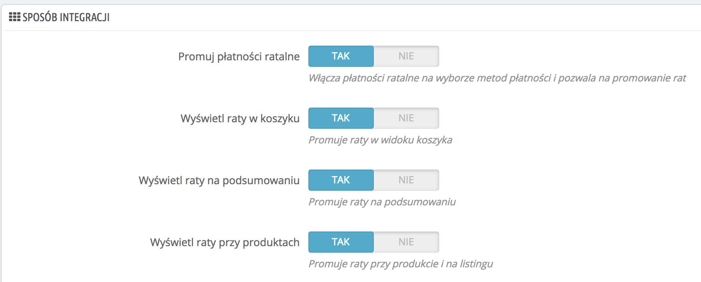

#### Presentation of installments and Buy Now Pay Later payment methods depending on PrestaShop version

| PrestaShop version | Category                                     | How it looks                                                                        |
|--------------------|----------------------------------------------|-------------------------------------------------------------------------------------|
| 1.7                | Product listing                              | 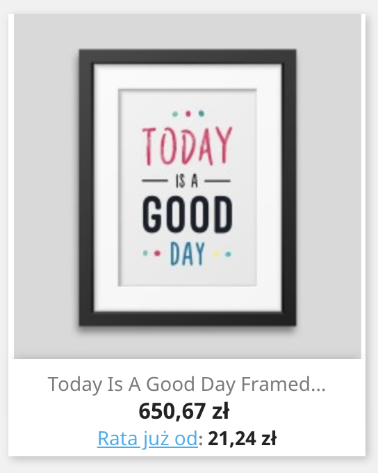                        |
| 1.7                | Product page                                 | 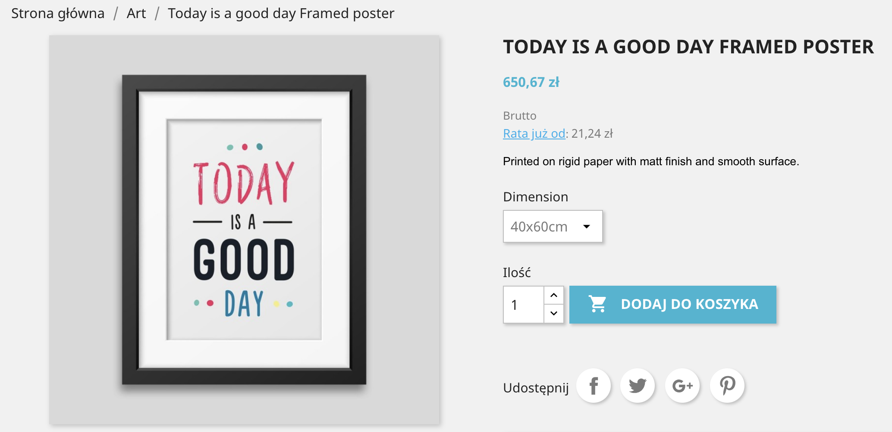                        |
| 1.7                | Cart                                         | 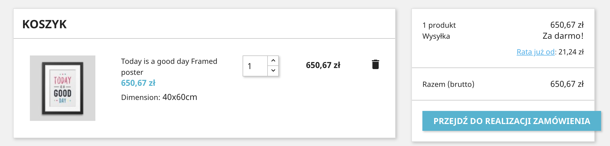                           |
| 1.7                | PayU Installments as a separate method       | 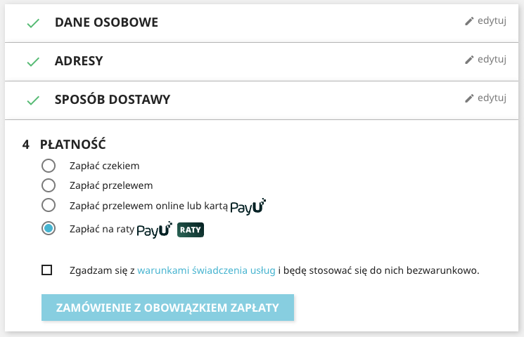 |
| 1.7                | Klarna payment as a separate method          | 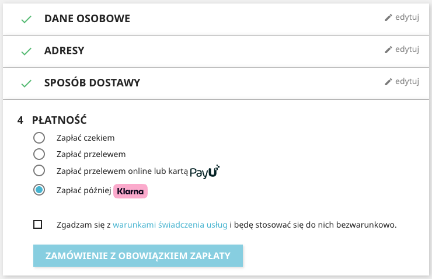       |
| 1.7                | PayPo payment as a separate method           |         |
| 1.7                | Twisto payment as a separate method          | 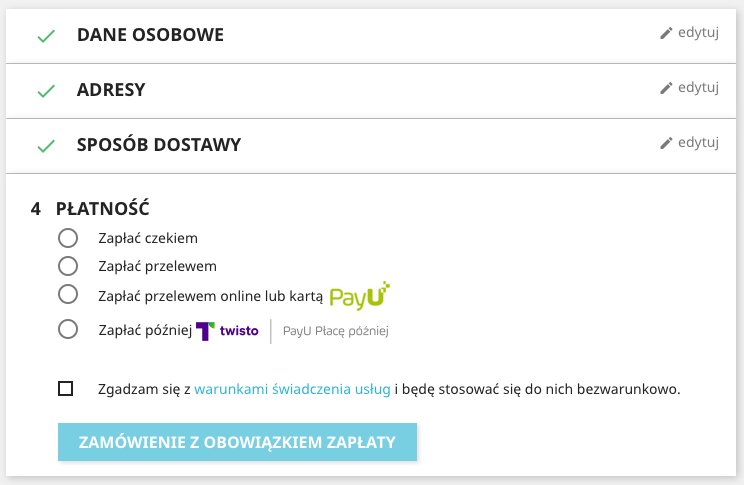       |
| 1.7                | Twisto Pay in 3 payment as a separate method | 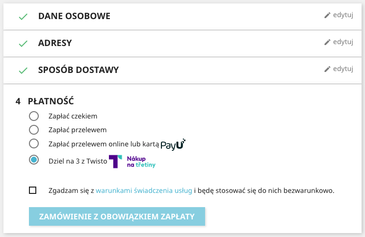 |
| 1.7                | PragmaPay payment as a separate method       | 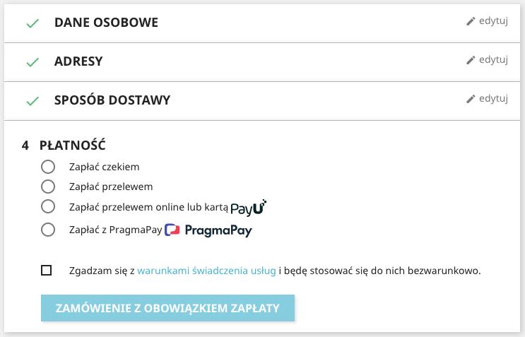   |
| 1.6                | Product listing                              | 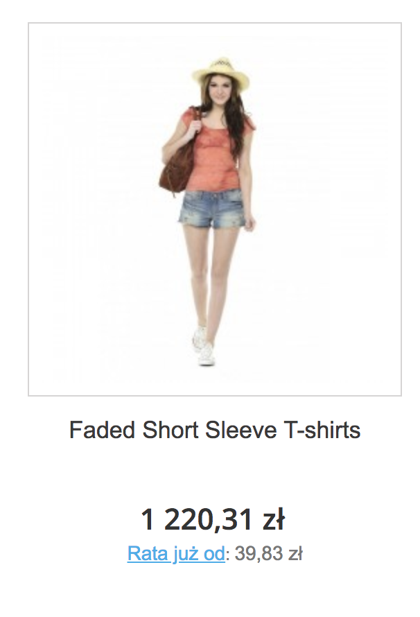                        |
| 1.6                | Product page                                 | 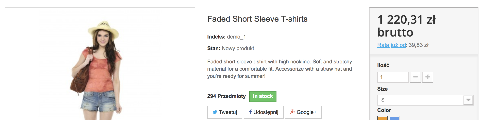                        |

#### Presentation of the credit payments widget

Depending on the available credit payment methods, one of the following links appears in the page sections mentioned
above: "Installment from", "0% installment from" or "Pay later". After clicking the link, the latest version of the
credit widget ("miniInstallment" component) appears. It is part of the [PayU Installments - best practices][ext12]
package, which can be found in the [official documentation][ext8].

The credit widget looks as follows:

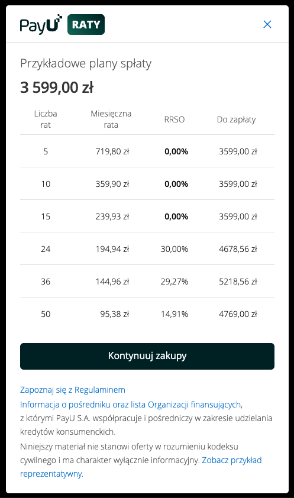

Since version 3.3.0, it is possible to exclude selected credit payment methods from the widget using the "Exclude
credit payment methods from widget" field in the module configuration. For example, entering `dpp,dpkl,dpt` in this
field removes PayPo, Klarna and Twisto from the widget:

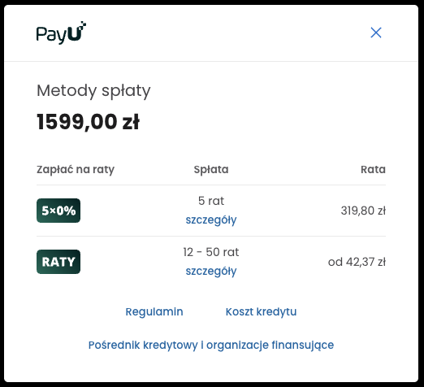

## Known issues

### PrestaShop and OPC modules

Because OPC modules build their own checkout page, some options may not work, e.g. `Bank list`,
`Separate card payment`, `Separate BLIK payment` and separation of credit payment methods. Please report such
problems to the OPC module authors.

<!--LINKS-->

<!--external links:-->

[ext0]: README.PL.md
[ext1]: http://php.net/manual/en/book.curl.php
[ext2]: http://php.net/manual/en/book.hash.php
[ext3]: https://github.com/PayU-EMEA/plugin_prestashop/releases
[ext4]: https://www.payu.pl/en/commercial-offer
[ext5]: https://secure.snd.payu.com/boarding/#/form&pk_campaign=Plugin-Github&pk_kwd=Prestashop
[ext6]: http://developers.payu.com/en/overview.html#paymethods
[ext7]: https://developers.payu.com/en/installments.html
[ext8]: https://developers.payu.com/en/installments.html#installments_best_practices_mini
[ext10]: https://www.payu.pl/en/payment-methods-business/payu-installments
[ext12]: https://developers.payu.com/en/installments.html#best_practices_title
[ext13]: https://www.payu.pl/en/help
[ext14]: https://developers.google.com/pay/api/web/guides/test-and-deploy/publish-your-integration#create-your-profile
[ext15]: https://developers.payu.com/europe/docs/payment-solutions/cards/digital-wallets/apple-pay/

<!--images:-->

[img3]: readme_images/en/bramki_platnosci.png
[img4]: readme_images/en/ponow_platnosc.png
[img5]: readme_images/en/widget.png
[img6]: readme_images/en/separate_card.png
[img7]: readme_images/en/google-pay.png
[img8]: readme_images/en/apple-pay.png
